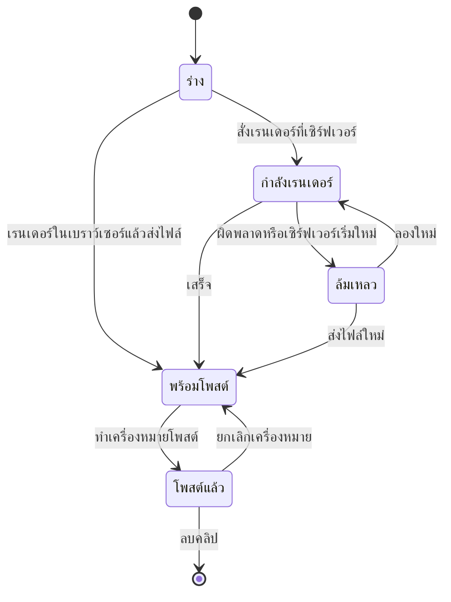
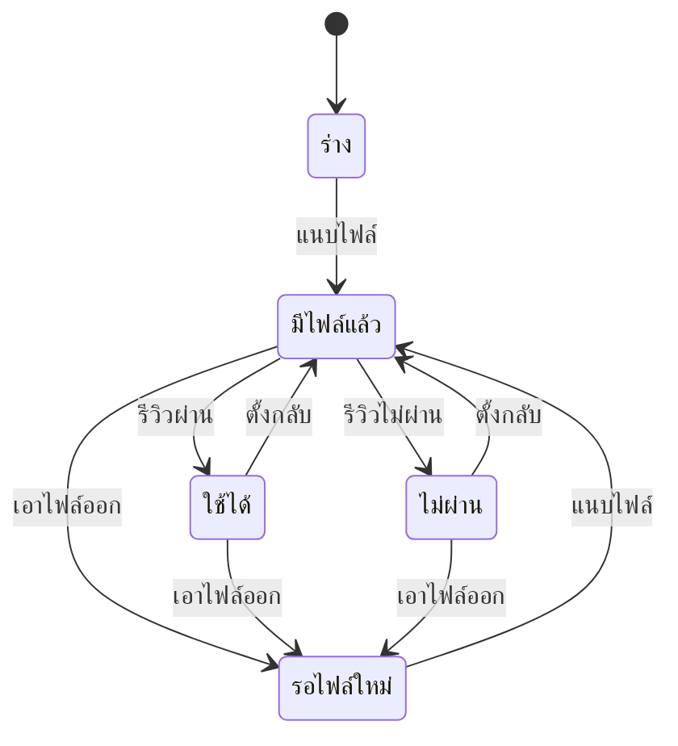
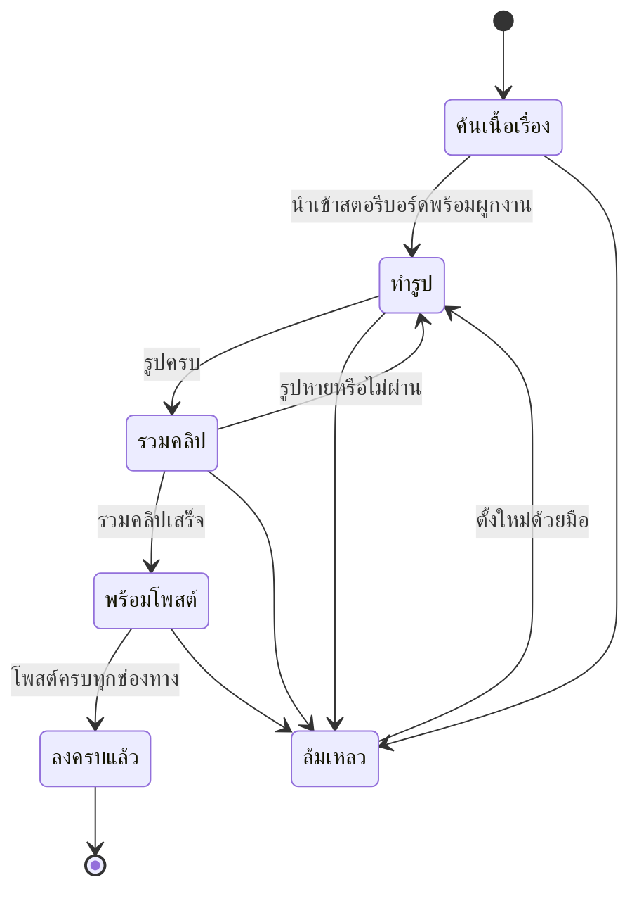
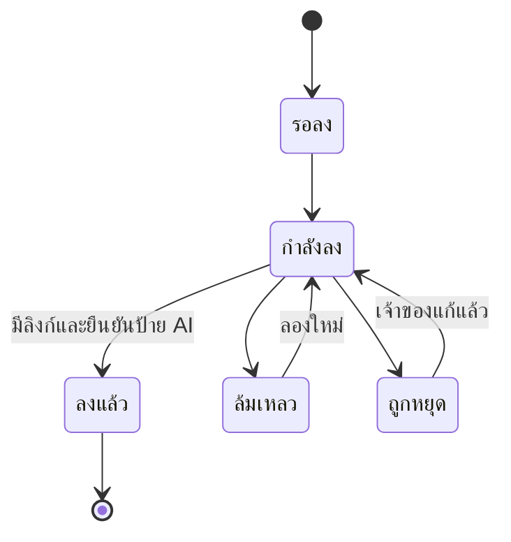

# ลำดับการทำงานของระบบ (System Flows)
## Arn Reels

อ้างอิงจาก 01-overview.md และ 02-features.md

เครื่องหมาย **(วางแผน)** หมายถึงขั้นตอนที่ยังไม่ได้ทำในระบบ ส่วน **(รอยืนยัน)** คือข้อเสนอของผม ดู 12-decisions.md

## สารบัญ Flow
1. Flow 1: เตรียมระบบครั้งแรก
2. Flow 2: ทำคลิปเร็วและเก็บเข้าคลัง
3. Flow 3: ทำคลิปจากข่าว
4. Flow 4: ทำคลิปพร้อมสินค้าแอฟฟิลิเอต
5. Flow 5: สร้างโปรเจกต์เรื่อง
6. Flow 6: ทำรูปและแนบรูปต่อช็อต
7. Flow 7: รวมเป็นคลิปเดียว
8. Flow 8: ผลิตตอนซีรีส์จนพร้อมโพสต์
9. Flow 9: โพสต์ตอนลงแต่ละช่องทาง **(วางแผน)**
10. Flow 10: งานรายวันอัตโนมัติ **(วางแผน)**
11. Flow 11: โพสต์มือและทำเครื่องหมายโพสต์แล้ว
12. สถานะของคลิป
13. สถานะของช็อต
14. สถานะของงานตอนซีรีส์
15. สถานะของการลง
16. ชุดคำสถานะที่ผู้ใช้เห็น (ข้อเสนอรวมคำ)
17. ค่าที่ตั้งได้ในระบบ

## ผู้เกี่ยวข้องในระบบ
- **เจ้าของระบบ** ผู้ใช้หน้าเว็บ Arn Reels และผู้ตัดสินใจทุกเรื่อง
- **ผู้ช่วย AI** ทำงานในแอป Claude Code ผ่านเบราว์เซอร์และเรียก API ของ Arn Reels แทนเจ้าของ
- **งานตั้งเวลา** Claude scheduled task เรียกผู้ช่วย AI ตามรอบวัน **(วางแผน)**
- **เว็บภายนอก** Gemini, ChatGPT, Google Flow (สร้างรูป) Facebook, YouTube (โพสต์) เว็บข่าว

## ขั้นตอนของเจ้าของกับ Flow ที่ตรงกัน

เจ้าของอธิบายระบบอัตโนมัติไว้ว่า: ค้นเนื้อเรื่อง → เขียนสตอรีบอร์ด → ทำรูป → รวมคลิป → โพสต์ Facebook แล้ว YouTube

| ขั้นของเจ้าของ | Flow |
|---|---|
| ค้นเนื้อเรื่อง และเขียนสตอรีบอร์ด | Flow 8 ขั้น 3 ถึง 5 |
| ทำรูป | Flow 6 (ใช้ใน Flow 8 ขั้น 6) |
| รวมคลิป | Flow 7 (ใช้ใน Flow 8 ขั้น 7) |
| โพสต์ Facebook แล้ว YouTube | Flow 9 |
| ทำทั้งหมดอัตโนมัติรายวัน | Flow 10 |

## Flow 1: เตรียมระบบครั้งแรก

**เงื่อนไขก่อนเริ่ม:** มี Node 22.5 ขึ้นไป และ Chrome หรือ Edge บนเครื่อง

**ขั้นตอน**
1. เจ้าของสั่งเริ่มเซิร์ฟเวอร์ (`start.ps1` หรือ `node server.js`) ระบบสร้างฐานข้อมูลและโฟลเดอร์ข้อมูลเอง
2. เจ้าของเปิดหน้าเว็บ แล้วเข้าหน้าตั้งค่า เลือกผู้ให้บริการ AI (บัญชี Claude Code หรือคีย์ API) ระบบตรวจว่าใช้ได้หรือไม่
3. เลือกเสียงบรรยาย (ใส่คีย์ Google หรือ Gemini ถ้าเลือกทางนั้น) และกดทดสอบเสียง
4. ตั้งสไตล์ประจำเพจและอัปโหลดโลโก้ (ไม่บังคับ)
5. ติดตั้งส่วนเสริม Chrome แล้วนำรหัสจับคู่ไปใส่ (ไม่บังคับ)
6. ล็อกอิน Gemini หรือ ChatGPT และ Facebook และ YouTube ในเบราว์เซอร์ที่ผู้ช่วย AI จะใช้ **(วางแผน)** เจ้าของล็อกอินเอง ผู้ช่วย AI ไม่ล็อกอินให้

**ผลลัพธ์:** หน้าเว็บแสดงว่าเรนเดอร์ AI และเสียงบรรยาย "ใช้ได้" (ชิปสถานะระบบมุมหน้าเว็บ ไม่ใช่สถานะของคลิป)

**กรณีอื่น**
- ไม่มี Claude Code ที่ล็อกอิน และไม่มีคีย์ API: ฟีเจอร์ที่ใช้ AI ใช้ไม่ได้ ฟีเจอร์อื่นยังใช้ได้ (นำเข้าสคริปต์เอง แนบรูปเอง)
- การล็อกอินเว็บภายนอกหลุดภายหลัง: งานที่ต้องใช้เว็บนั้นหยุด (ดู Flow 6 และ Flow 9)

## Flow 2: ทำคลิปเร็วและเก็บเข้าคลัง

**เงื่อนไขก่อนเริ่ม:** ตั้งค่า AI แล้ว (ถ้าจะให้ AI เขียนสคริปต์)

**ขั้นตอน**
1. เจ้าของใส่หัวข้อหรือเนื้อหาในหน้าหลัก หรือกดให้ AI ค้นความรู้จากคีย์เวิร์ด หรือวางรูปให้ AI อ่าน
2. เจ้าของกดให้ AI แตกเป็นสคริปต์ ระบบสร้างคลิปสถานะ "ร่าง" พร้อมสคริปต์
3. เจ้าของเลือกสไตล์พื้นหลัง เสียงบรรยาย เพลง ป้ายหัวคลิป
4. เจ้าของกดเรนเดอร์ หน้าเว็บวาดแต่ละฉากลงผืนผ้าใบและอัดเป็นวิดีโอ เมื่อเสร็จส่งไฟล์เข้าเซิร์ฟเวอร์
5. ระบบเปลี่ยนคลิปเป็น "พร้อมโพสต์" และเก็บความยาวกับภาพหน้าปก
6. เจ้าของกดให้ AI เขียนแคปชันและแฮชแท็ก แล้วแก้ได้

**ผลลัพธ์:** คลิป "พร้อมโพสต์" ในคลัง มีแคปชัน

**กรณีอื่น**
- ปิดหรือรีเฟรชหน้าตอนเรนเดอร์: งานหายและต้องเริ่มเรนเดอร์ใหม่ (ไฟล์ยังไม่ถูกส่ง)
- กดหยุดบนการ์ดความคืบหน้า: เลิกเรนเดอร์ ไม่บันทึกอะไรลงคลัง
- เบราว์เซอร์ไม่รองรับการอัด: ระบบแจ้งให้ใช้ Chrome หรือ Edge
- ความยาวเกินเพดานของคลิปเร็ว: ระบบปฏิเสธและบอกให้ลดจำนวนฉาก (ค่าเพดานดูตาราง "ค่าที่ตั้งได้ในระบบ")

## Flow 3: ทำคลิปจากข่าว

**เงื่อนไขก่อนเริ่ม:** เพิ่มฟีดข่าวอย่างน้อยหนึ่งฟีด

**ขั้นตอน**
1. เจ้าของเปิดโหมดข่าว ระบบดึงรายการข่าวล่าสุดจากฟีด (แคชไว้ช่วงหนึ่ง)
2. เจ้าของเลือกข่าวหนึ่งหน้า ระบบดึงเนื้อบทความ (ปฏิเสธลิงก์ที่ชี้เข้าเครือข่ายภายใน)
3. ระบบให้ AI เรียบเรียงใหม่พร้อมที่มา ไม่บันทึกอะไร หน้าเว็บนำไปกรอกในฟอร์ม
4. เจ้าของทำต่อตั้งแต่ Flow 2 ขั้น 2 เลือกดึงรูปจริงจากลิงก์ข่าวมาเป็นพื้นหลังได้

**ผลลัพธ์:** คลิปข่าว "พร้อมโพสต์" พร้อมที่มา

**กรณีอื่น**
- เว็บข่าวบล็อกการดึงบทความ: ระบบแจ้งข้อผิดพลาด เจ้าของวางเนื้อหาเอง
- รูปจากลิงก์ไม่พอ: เจ้าของค้นรูปจากหน้าเว็บแล้วเลือกเอง

## Flow 4: ทำคลิปพร้อมสินค้าแอฟฟิลิเอต

> **อัปเดต 30 ต.ค. 2026:** Flow นี้เป็นทางเก่า (ใส่สินค้าในแคปชันของคลิปเร็ว) งานหลักตอนนี้คือ "คลิปแนะนำสินค้า" ใน 14-product-clips.md ซึ่งใช้คลังสินค้าในแอป

**เงื่อนไขก่อนเริ่ม:** มือถือที่ลงแอป Pondy เสียบเครื่องและเปิด adb

**ขั้นตอน**
1. เจ้าของเสียบมือถือที่เปิด adb ระบบแสดงรายการเครื่อง
2. เจ้าของกดดูก่อนนำเข้าหรือดูรายการ ระบบคัดลอกฐานข้อมูลของแอป Pondy มาอ่านแบบอ่านอย่างเดียว แล้วนับรายการที่ตรงเงื่อนไข
3. เมื่อทำคลิป เจ้าของเลือกให้ AI เลือกสินค้าที่เข้ากับเรื่องจากสิบอันดับขายดี (หรือสามอันดับแรก) หรือเลือกเอง
4. ระบบคืนข้อเสนอสินค้า หน้าเว็บนำไปใส่ในแคปชัน ไม่มีฟิลด์ผูกสินค้ากับคลิปในฐานข้อมูล
5. นำเข้าสินค้าเข้าคลังสินค้าในแอป (ปุ่ม 🛍 สินค้า) แล้วให้ AI เลือกจากคลัง

**ผลลัพธ์:** คลิปมีสินค้าและลิงก์อยู่ในแคปชัน

**กรณีอื่น**
- ไม่พบเครื่องหรือ adb ไม่ตอบ: ระบบแจ้ง "ติดต่อมือถือไม่ได้" ไม่ล้มทั้งแอป
- ล้างสินค้าที่นำเข้าได้ทีเดียว (ไม่ลบสินค้าที่เพิ่มเอง)

## Flow 5: สร้างโปรเจกต์เรื่อง

**เงื่อนไขก่อนเริ่ม:** มีสคริปต์สตอรีบอร์ด หรือมีหัวข้อให้ AI เขียน

**ขั้นตอน**
1. เจ้าของเลือกทางสร้างอย่างใดอย่างหนึ่ง
   - นำเข้าสคริปต์สำเร็จรูป ระบบแยกชื่อเรื่อง ตัวละคร และช็อตจากหัวฉากและคำพูดในเครื่องหมายคำพูด โดยไม่ใช้ AI
   - ให้ AI เขียนสตอรีบอร์ดจากหัวข้อ (เลือกค้นข้อมูลจริงได้) แล้วนำเข้าด้วยวิธีเดียวกัน
   - เรื่องล้อเลียนผลบอลโดย AI แล้วนำเข้าด้วยวิธีเดียวกัน
   - สร้างโปรเจกต์ว่างแล้วเพิ่มช็อตเอง หรือขยายจากคลิปเร็ว
2. ระบบสร้างโปรเจกต์ ตัวละคร และช็อตทั้งหมดในธุรกรรมเดียว ถ้าขั้นใดล้มจะไม่ทิ้งโปรเจกต์ค้างครึ่งทาง
3. ถ้าสคริปต์มี Caption, คำเสียง, และระดับสปอยล์ และเลือกเทมเพลต B ระบบบันทึกลงช็อต
4. ระบบสร้างพรอมต์ต่อช็อตจากคลังตัวละคร โทนภาพ และคำบรรยาย
5. เจ้าของตรวจและแก้ช็อต ตัวละคร คำบรรยาย

**ผลลัพธ์:** โปรเจกต์ที่มีช็อตครบและพรอมต์พร้อม รอรูป

**กรณีอื่น**
- สคริปต์ไม่มีหัวฉาก: ระบบแจ้ง "ไม่พบหัวฉาก" พร้อมวิธีเขียนที่ถูก
- ไม่มีช่วงเวลาหรือบทพูดไทยในสคริปต์: ระบบเตือน ใช้ช็อตละ 8 วินาที และให้ AI เขียนคำบรรยายทีหลัง
- สคริปต์เกิน 80 ฉากหรือ 30,000 ตัวอักษร: ระบบปฏิเสธ

## Flow 6: ทำรูปและแนบรูปต่อช็อต

**เงื่อนไขก่อนเริ่ม:** โปรเจกต์มีช็อตและพรอมต์ ผู้สร้างรูปที่เลือกล็อกอินอยู่ในเบราว์เซอร์

**ขั้นตอน**
1. ผู้ช่วย AI หรือเจ้าของส่งพรอมต์ของช็อตไปผู้สร้างรูป (ตัดข้อความภาษาไทยออกกันภาพมีตัวอักษร) แชตใหม่ต่อช็อต
2. ผู้สร้างรูปคืนรูป รอประมาณ 1 ถึง 2 นาทีต่อช็อต
3. นำรูปลงเครื่อง ผ่านโฟลเดอร์ดาวน์โหลด หรือส่วนเสริม Chrome
4. อัปโหลดเข้าช็อต ระบบตรวจว่าเป็นรูปจริง ขนาดไม่เกิน 25 MB และเก็บลงโฟลเดอร์ข้อมูล ช็อตเปลี่ยนเป็น "มีไฟล์แล้ว"
5. เจ้าของรีวิวรูป ทำเครื่องหมาย "ใช้ได้" หรือ "ไม่ผ่าน" ช็อตที่ไม่ผ่านจะไม่ถูกรวมเข้าคลิป
6. ถ้าเลย์เอาต์ช็อตเป็นแบ่งสองช่อง แนบรูปที่สองด้วย

**ผลลัพธ์:** ทุกช็อตที่ใช้มีรูป

**กรณีอื่น**
- ผู้สร้างรูปขอให้ล็อกอิน: **หยุดทันที** ผู้ช่วย AI ไม่ล็อกอินหรือสมัครบัญชีให้ แจ้งเจ้าของให้ล็อกอินเอง (เกิดจริงกับ ChatGPT และ Gemini)
- ผู้สร้างรูปปฏิเสธพรอมต์หรือรูปไม่ตรง: ลองใหม่ได้ครั้งเดียวต่อช็อต แล้วหยุดแจ้งเจ้าของ
- ไฟล์ดาวน์โหลดค้างเป็นไฟล์ชั่วคราว: ตรวจว่าเป็น PNG จริงแล้วใช้ไฟล์นั้น
- เว็บภายนอกส่งไฟล์เข้าแอปโดยตรงไม่ได้ (ระบบตรวจ Origin) จึงต้องผ่านการดาวน์โหลด (ประเด็นที่ 11)

## Flow 7: รวมเป็นคลิปเดียว

**เงื่อนไขก่อนเริ่ม:** ช็อตที่ใช้มีรูปครบ เปิดหน้าเรื่องบน Chrome หรือ Edge

**ขั้นตอน**
1. เจ้าของเปิดแท็บ "ช็อต" เลือกเทมเพลต (ธรรมดา หรือ B) เสียงบรรยาย ซับไตเติล เพลง
2. ถ้าเป็นเทมเพลต B ระบบเติมป้ายตอน การ์ดปก การ์ดจบจากค่าของโปรเจกต์ ระดับสปอยล์ที่เป็น "อัตโนมัติ" ไล่ 1 ถึง 5 ตามลำดับช็อต
3. เจ้าของกด "รวมเป็นคลิปเดียว" ระบบขอเสียงบรรยายทีละช็อต (ผ่านผู้ให้บริการเสียงที่เลือก แคชไว้)
4. หน้าเว็บวาดทุกช็อตและอัดเป็นวิดีโอ ความยาวช็อตเท่าเสียงบรรยาย (ถ้าไม่มีเสียงใช้ค่าตั้งต้น) เทมเพลต B มิกซ์เสียงแน่นและใส่เสียงเอฟเฟกต์
5. เมื่อเสร็จ สร้างคลิปชนิด "เรื่อง" ในคลัง ส่งไฟล์และภาพหน้าปก แล้วให้ AI เขียนแคปชัน
6. หน้าเรียกบอกโปรเจกต์ว่ารวมเสร็จ ถ้าโปรเจกต์ผูกกับงานตอนซีรีส์อยู่ งานเปลี่ยนเป็น "พร้อมโพสต์" (Flow 8)

**ผลลัพธ์:** คลิปในคลังและ (ถ้ามี) งานตอนพร้อมโพสต์

**กรณีอื่น**
- เทมเพลต B กับสัดส่วนที่ไม่ใช่ 9:16: ระบบปฏิเสธ
- ช็อตแบ่งสองช่องไม่มีรูปที่สอง: ระบบแจ้งว่าช็อตที่เท่าใดขาดรูป ไม่วาดครึ่งเดียว
- รวมคลิปเสร็จ แต่ขั้นแจ้งงานตอนไม่สำเร็จ: คลิปยังอยู่ในคลัง งานตอนยังไม่ขยับ ต้องแก้ด้วยมือ (ผู้ช่วย AI ตรวจแล้วสั่ง PATCH ได้)
- ปิดหน้าตอนรวม: ไม่มีอะไรถูกบันทึก เริ่มใหม่
- ความยาวรวมเกินเพดานของคลิปรวมเรื่อง: ระบบปฏิเสธและบอกให้ลดจำนวนช็อต
- คลิปยาวกว่าแผนประมาณ 1 วินาที (เวลาประวิงของตัวอัด) เป็นปกติ

## Flow 8: ผลิตตอนซีรีส์จนพร้อมโพสต์

**เงื่อนไขก่อนเริ่ม:** มีซีรีส์ที่เปิดอยู่ มีแหล่งอ่านเนื้อเรื่อง ผู้สร้างรูปล็อกอินแล้ว

**ขั้นตอน**
1. เจ้าของหรือผู้ช่วย AI เริ่มตอนถัดไป ระบบตรวจว่าซีรีส์เปิดอยู่ ไม่เกินตอนต่อวัน และเลขตอนไม่ซ้ำ แล้วสร้างงานตอนสถานะ "ค้นเนื้อเรื่อง" และเลื่อนเลขตอนถัดไป
2. ถ้าไม่ผ่านเงื่อนไขข้อใด ระบบปฏิเสธพร้อมเหตุผล (ไม่ใช้ตัวเลือกบังคับ)
3. ผู้ช่วย AI อ่านบทนิยายตามช่วงบทของตอนนั้น (chapter_range ที่ระบบคำนวณตอนเริ่มตอน) จากแหล่งที่ตั้งไว้ สรุปเป็น 6 ถึง 12 ฉากด้วยคำของเราเอง ห้ามแต่ง ถ้าช่วงบทว่างหรืออ่านไม่ได้ ตั้งงานเป็นล้มเหลว
4. ผู้ช่วย AI เขียนสตอรีบอร์ดตามสูตรเทมเพลต B
5. นำเข้าพร้อมผูกงานตอน ระบบสร้างโปรเจกต์ ตั้งเทมเพลต B และค่าจากซีรีส์ (ป้ายตอน การ์ดปกและจบ เครดิต) แล้วงานเป็น "ทำรูป"
6. ผู้ช่วย AI ทำ Flow 6 จนทุกช็อตมีรูป ระบบเปลี่ยนงานเป็น "รวมคลิป" เมื่อรูปครบ และกลับเป็น "ทำรูป" ถ้ารูปหายหรือถูกตีว่าไม่ผ่าน
7. ผู้ช่วย AI ทำ Flow 7 เมื่อรวมเสร็จ งานเป็น "พร้อมโพสต์" พร้อมเลขคลิป
8. ในการทำงานอัตโนมัติ ผู้ช่วย AI วาดรูปเองโดยไม่ถามเจ้าของ **(วางแผน)** (ประเด็นที่ 7 ตัดสินใจแล้ว) ช่วงที่ยังเป็นงานมือ ผู้ช่วย AI ถามก่อนวาด (ตามที่ตกลงไว้เดิม)

**ผลลัพธ์:** งานตอนสถานะ "พร้อมโพสต์" มีเลขคลิป

**กรณีอื่น**
- ซีรีส์ปิดอยู่: ระบบปฏิเสธการเริ่มตอน
- ครบตอนต่อวันแล้ว: ระบบปฏิเสธ ตอนที่ล้มเหลวไม่นับรวม
- ผู้สร้างรูปขอล็อกอิน หรือเนื้อเรื่องอ่านไม่ได้ หรือบทพูดหายจากสคริปต์ หรือเรนเดอร์ล้ม: ผู้ช่วย AI ตั้งงานเป็น "ล้มเหลว" พร้อมเหตุผล แล้วหยุด ไม่ลองซ้ำเอง
- เกิดสภาพที่งานค้างขั้นนาน: ยังไม่มีเวลาหมดอายุหรือการแจ้งเตือน **(วางแผน)** (ประเด็นที่ 17)
- ตอนที่ผูกโปรเจกต์แล้ว ผูกโปรเจกต์ที่สองไม่ได้ และโปรเจกต์หนึ่งผูกได้กับงานเดียว

## Flow 9: โพสต์ตอนลงแต่ละช่องทาง (วางแผน)

**เงื่อนไขก่อนเริ่ม:** งานตอนเป็น "พร้อมโพสต์" ช่องทางที่เลือกของตอนนี้ล็อกอินอยู่ ชื่อเพจหรือช่องตั้งไว้

**ขั้นตอน**
1. ผู้ช่วย AI สร้างรายการลงของช่องทางแรก (Facebook) ระบบปฏิเสธถ้าตอนไม่ใช่ "พร้อมโพสต์" ช่องทางไม่ได้เลือกไว้ หรือมีรายการลงของช่องทางนั้นแล้ว
2. ผู้ช่วย AI เปลี่ยนรายการลงเป็น "กำลังลง" แล้วเปิดหน้าเพจจากชื่อที่ตั้งไว้ในเบราว์เซอร์ที่ล็อกอินอยู่ ตรวจว่าชื่อเพจตรงก่อนทำอะไรต่อ
3. อัปโหลดคลิป ใส่แคปชันและแฮชแท็กจากคลิป
4. ติ๊กป้ายเนื้อหา AI แล้วอ่านค่ากลับมายืนยัน ถ้าหาตัวเลือกไม่เจอหรือยืนยันไม่ได้ ไม่โพสต์ ตั้งรายการลงเป็น "ถูกหยุด"
5. กดโพสต์ จดลิงก์ของโพสต์
6. บันทึกรายการลงเป็น "ลงแล้ว" พร้อมลิงก์และค่ายืนยันป้าย ระบบปฏิเสธถ้าไม่มีลิงก์หรือยังไม่ยืนยันป้าย
7. เมื่อโพสต์ครบทุกช่องทางที่เลือก งานตอนเป็น "ลงครบแล้ว" เอง
8. ช่องทางที่สอง (YouTube) ทำซ้ำขั้น 1 ถึง 6 โดยเว้นช่วงหลังช่องทางแรก (ประเด็นที่ 12)

**ผลลัพธ์:** งานตอน "ลงครบแล้ว" พร้อมลิงก์ทุกช่องทาง

**กรณีอื่น**
- เด้งหน้าล็อกอิน หรือ CAPTCHA: หยุด ตั้ง "ถูกหยุด" พร้อมเหตุผล ไม่ผ่านเอง
- อัปโหลดไม่ผ่าน หรือหน้าจอไม่ตรงที่คาด: หยุด ตั้ง "ล้มเหลว"
- Facebook ผ่านแต่ YouTube ล้ม: ล้มแยกกัน ไม่ย้อนกลับโพสต์ที่ผ่านแล้ว ตอนค้างเป็น "พร้อมโพสต์" จนกว่าครบ
- ตอนนี้โพสต์แล้ว (ลงแล้ว): แก้รายการนั้นไม่ได้ กันโพสต์ซ้ำ
- เอาช่องทางที่เริ่มลงแล้วออกจากตอนไม่ได้
- ช่องทางที่ถูกเอาออกก่อนเริ่มลง: ตอนไม่ต้องรอช่องทางนั้น
- ก่อนเปิดงานรายวันต้องทดสอบโพสต์คลิปทดสอบ 1 คลิปต่อช่องทาง โดยเจ้าของอนุมัติทุกครั้ง (plans/poc-plan.md)

## Flow 10: งานรายวันอัตโนมัติ (วางแผน)

**เงื่อนไขก่อนเริ่ม:** ซีรีส์เปิดอยู่ ผ่านการทดสอบโพสต์ครบแล้ว เครื่องเปิดอยู่ เบราว์เซอร์ล็อกอินค้าง

**ขั้นตอน**
1. งานตั้งเวลาเริ่มก่อนเวลาโพสต์ประมาณ 2 ชั่วโมง (เพราะเรนเดอร์ต้องเรียลไทม์ ค่าประมาณ)
2. ผู้ช่วย AI ตรวจว่าเซิร์ฟเวอร์ทำงาน ถ้าไม่ทำงานให้เริ่มก่อน
3. ทำ Flow 8 หนึ่งตอน
4. เมื่อคลิปพร้อมและถึงเวลาโพสต์ที่ตั้งไว้ในซีรีส์ ทำ Flow 9 ทันที ถ้าคลิปพร้อมก่อนเวลา ให้รอถึงเวลา ถ้าเลยเวลาแล้วจึงพร้อม ให้โพสต์ทันที **(รอยืนยัน)** ประเด็นที่ 12 ส่วนการไม่รออนุมัติจากเจ้าของ ตัดสินใจแล้ว (ประเด็นที่ 8)
5. รายงานผลต่อเจ้าของ

**ผลลัพธ์:** วันนั้นมีหนึ่งตอนลงครบหรือมีงานล้มพร้อมเหตุผล

**กรณีอื่น**
- เครื่องหลับ ปิด หรือ Chrome ถูกปิด: งานรอบนั้นล้ม
- ล็อกอินหลุด: ล้มที่ขั้นรูปหรือขั้นโพสต์ ตั้งงานเป็นล้มเหลว
- งานรันซ้ำในวันเดียว: ระบบกันด้วยจำนวนตอนต่อวันและเลขตอนไม่ซ้ำ จึงไม่เกิดตอนซ้ำ
- ผู้สร้างรูปเปลี่ยนหน้าตาเว็บ: งานล้มที่ขั้นรูป
- เจ้าของปิดซีรีส์: งานรอบถัดไปไม่เริ่ม (ปุ่มหยุดฉุกเฉิน)

## Flow 11: โพสต์มือและทำเครื่องหมายโพสต์แล้ว

**เงื่อนไขก่อนเริ่ม:** คลิปในคลังเป็น "พร้อมโพสต์"

**ขั้นตอน**
1. เจ้าของดาวน์โหลดคลิปและแคปชัน แล้วโพสต์ลง Facebook เอง
2. เจ้าของกด "โพสต์แล้ว" ใส่ลิงก์โพสต์ (ไม่บังคับ) คลิปเปลี่ยนเป็น "โพสต์แล้ว"
3. เปลี่ยนใจได้: กดยกเลิก คลิปกลับเป็น "พร้อมโพสต์" (หรือ "ร่าง" ถ้าไม่มีไฟล์)

**ผลลัพธ์:** คลิปมีเวลาโพสต์และลิงก์

**กรณีอื่น**
- ฟิลด์ "โพสต์แล้ว" นี้ใช้กับโพสต์มือเท่านั้น สำหรับซีรีส์ ใช้ตารางการลง (ประเด็นที่ 4)

## สถานะของคลิป

| สถานะ | ความหมาย | เปลี่ยนมาจาก | เปลี่ยนไปเป็น |
|---|---|---|---|
| ร่าง | มีสคริปต์ ยังไม่มีไฟล์วิดีโอ | สร้างใหม่ / ยกเลิกโพสต์ที่ไม่มีไฟล์ | กำลังเรนเดอร์ พร้อมโพสต์ |
| กำลังเรนเดอร์ | เซิร์ฟเวอร์กำลังเรนเดอร์ด้วย ffmpeg (เรนเดอร์ในเบราว์เซอร์ไม่ผ่านสถานะนี้) | ร่าง พร้อมโพสต์ ล้มเหลว | พร้อมโพสต์ ล้มเหลว |
| พร้อมโพสต์ | มีไฟล์วิดีโอแล้ว | ร่าง กำลังเรนเดอร์ ล้มเหลว โพสต์แล้ว (ยกเลิก) | โพสต์แล้ว กำลังเรนเดอร์ (เรนเดอร์ใหม่) |
| ล้มเหลว | เรนเดอร์ไม่สำเร็จ หรือเซิร์ฟเวอร์เริ่มใหม่ระหว่างเรนเดอร์ | กำลังเรนเดอร์ | กำลังเรนเดอร์ พร้อมโพสต์ (อัปโหลดไฟล์ใหม่) |
| โพสต์แล้ว | เจ้าของยืนยันว่าโพสต์แล้ว | พร้อมโพสต์ | พร้อมโพสต์ (ยกเลิก) ลบ |

สถานะสุดท้ายคือ "โพสต์แล้ว" เปิดกลับได้ด้วยการยกเลิก

## สถานะของช็อต

| สถานะ | ความหมาย | เปลี่ยนมาจาก | เปลี่ยนไปเป็น |
|---|---|---|---|
| ร่าง | ช็อตใหม่ ยังไม่มีไฟล์ | สร้างใหม่ | มีไฟล์แล้ว |
| รอไฟล์ใหม่ | เคยมีไฟล์แล้วเอาออก (ค่าในโปรแกรมต่างจาก "ร่าง" แต่ความหมายเดียวกัน ดูประเด็นที่ 3) | มีไฟล์แล้ว ใช้ได้ ไม่ผ่าน | มีไฟล์แล้ว |
| มีไฟล์แล้ว | แนบรูปหรือคลิปแล้ว ยังไม่รีวิว | ร่าง รอไฟล์ใหม่ ใช้ได้ ไม่ผ่าน (ตั้งกลับ) | ใช้ได้ ไม่ผ่าน รอไฟล์ใหม่ |
| ใช้ได้ | เจ้าของรีวิวว่าใช้ได้ | มีไฟล์แล้ว | มีไฟล์แล้ว (ตั้งกลับ) รอไฟล์ใหม่ |
| ไม่ผ่าน | เจ้าของรีวิวว่าไม่ผ่าน ไม่ถูกรวมเข้าคลิป และไม่นับเป็นช็อตที่มีรูป | มีไฟล์แล้ว | มีไฟล์แล้ว (ตั้งกลับ) รอไฟล์ใหม่ |

ไม่มีสถานะสุดท้าย ช็อตหายไปเมื่อลบช็อตหรือโปรเจกต์

## สถานะของงานตอนซีรีส์

| สถานะ | ความหมาย | เปลี่ยนมาจาก | เปลี่ยนไปเป็น |
|---|---|---|---|
| ค้นเนื้อเรื่อง | สร้างงานแล้ว กำลังอ่านเนื้อเรื่อง | เริ่มตอน | ทำรูป (เมื่อนำเข้าพร้อมผูกโปรเจกต์) ล้มเหลว |
| เขียนสตอรีบอร์ด | กำลังเขียนสตอรีบอร์ด (ตั้งได้ด้วยมือเท่านั้น ในทางปกติการนำเข้าข้ามไป "ทำรูป") | ค้นเนื้อเรื่อง | ทำรูป ล้มเหลว |
| ทำรูป | มีโปรเจกต์แล้ว รูปยังไม่ครบ | ค้นเนื้อเรื่อง เขียนสตอรีบอร์ด รวมคลิป | รวมคลิป ล้มเหลว |
| รวมคลิป | รูปครบทุกช็อตที่ใช้ รอรวมเป็นคลิป | ทำรูป | พร้อมโพสต์ ทำรูป (รูปหาย) ล้มเหลว |
| พร้อมโพสต์ | รวมคลิปเสร็จ มีเลขคลิป | รวมคลิป ล้มเหลว (ตั้งใหม่มีเลขคลิป) | ลงครบแล้ว ล้มเหลว |
| ลงครบแล้ว | โพสต์ครบทุกช่องทางที่เลือก (สถานะสุดท้าย) | พร้อมโพสต์ (ระบบตั้งเอง) | ไม่มี แก้ไม่ได้ |
| ล้มเหลว | ขั้นใดขั้นหนึ่งล้ม มีเหตุผลกำกับ | ทุกสถานะ ยกเว้นลงครบแล้ว | ขั้นใดก็ได้ที่ตั้งด้วยมือ (ผู้ช่วย AI หรือเจ้าของ) |

"ลงครบแล้ว" ตั้งเองไม่ได้ ระบบตั้งให้เมื่อโพสต์ครบเท่านั้น "พร้อมโพสต์" ตั้งไม่ได้ถ้าไม่มีเลขคลิป เปลี่ยนช่องทางของตอนทำให้ตอนเป็น "ลงครบแล้ว" ได้ถ้าช่องที่เหลือโพสต์ครบแล้ว

## สถานะของการลง

| สถานะ | ความหมาย | เปลี่ยนมาจาก | เปลี่ยนไปเป็น |
|---|---|---|---|
| รอลง | สร้างรายการแล้ว ยังไม่เริ่ม | สร้างรายการ | กำลังลง ล้มเหลว ถูกหยุด |
| กำลังลง | ผู้ช่วย AI กำลังโพสต์ | รอลง ล้มเหลว ถูกหยุด | ลงแล้ว ล้มเหลว ถูกหยุด |
| ลงแล้ว | โพสต์สำเร็จ มีลิงก์และยืนยันป้าย AI แล้ว (สถานะสุดท้าย) | กำลังลง | ไม่มี แก้ไม่ได้ |
| ล้มเหลว | โพสต์ไม่สำเร็จ มีเหตุผล | รอลง กำลังลง | กำลังลง (ลองใหม่) |
| ถูกหยุด | หยุดเพราะล็อกอิน CAPTCHA ยืนยันป้ายไม่ได้ หรือหน้าจอไม่ตรง | รอลง กำลังลง | กำลังลง (หลังเจ้าของแก้แล้ว) |

## ชุดคำสถานะที่ผู้ใช้เห็น (ข้อเสนอรวมคำ)

ปัญหาเดิม: คำว่า "ready" ปรากฏเป็นสถานะของคลิป ช็อต และงานตอน โดยความหมายต่างกัน และแต่ละที่ใช้ชุดคำคนละแบบ ข้อเสนอ (ใช้ค่าที่เสนอไปก่อน รอยืนยัน ประเด็นที่ 3):

- คำว่า **"พร้อมโพสต์"** ใช้ได้เฉพาะสิ่งที่พร้อมให้โพสต์จริง คือ คลิป และงานตอน (ที่มีเลขคลิป) เท่านั้น
- ช็อตไม่ใช้คำว่า "พร้อม" ค่า `draft` กับ `ready` ของช็อตแสดงเป็น "ร่าง" ทั้งคู่ และเสนอให้เหลือค่าเดียว
- คำที่ใช้ร่วมกันทุกสิ่ง: "ร่าง", "ล้มเหลว", "ถูกหยุด" (เฉพาะการลง), "ลงแล้ว" (การลง) กับ "โพสต์แล้ว" (คลิป: โพสต์มือ)

| สิ่งที่ติดตาม | ชื่อที่ผู้ใช้เห็น (ตามลำดับ) |
|---|---|
| ช็อต | ร่าง → มีไฟล์แล้ว → ใช้ได้ / ไม่ผ่าน (ค่า ready ของช็อตแสดงว่า "รอไฟล์ใหม่" ทำแล้วบนหน้าจอ) |
| คลิป | ร่าง → กำลังเรนเดอร์ → พร้อมโพสต์ → โพสต์แล้ว / ล้มเหลว |
| งานตอนซีรีส์ | ค้นเนื้อเรื่อง → เขียนสตอรีบอร์ด → ทำรูป → รวมคลิป → พร้อมโพสต์ → ลงครบแล้ว / ล้มเหลว |
| การลง | รอลง → กำลังลง → ลงแล้ว / ล้มเหลว / ถูกหยุด |

## ค่าที่ตั้งได้ในระบบ

ตารางนี้เป็นที่เดียวที่เขียนค่าเริ่มต้นของเวลา เพดาน และจำนวน ไฟล์อื่นอ้างมาที่นี่

| ค่า | ค่าเริ่มต้น | ใช้ที่ใด |
|---|---|---|
| ความยาวคลิปเร็วสูงสุด (ความยาวเป้าหมายตั้งได้ 5 ถึง 90 วินาที) | 90 วินาที (เพดานของ Reels) | Flow 2 |
| ความยาวคลิปรวมเรื่องสูงสุด | 900 วินาที (15 นาที) | Flow 7 |
| ขนาดไฟล์คลิปที่ส่งเข้าคลังสูงสุด | 300 MB | Flow 2 Flow 7 |
| เวลาเริ่มต้นของช็อต | 8 วินาที | Flow 5 |
| ความยาวสูงสุดของช็อตเดียว | 20 วินาที | Flow 5 |
| จำนวนฉากสูงสุดของสคริปต์ที่นำเข้า | 80 ฉาก | Flow 5 |
| ความยาวสคริปต์ที่นำเข้าสูงสุด | 30,000 ตัวอักษร | Flow 5 |
| ขนาดรูปที่แนบสูงสุด | 25 MB | Flow 6 |
| ขนาดคลิปที่แนบสูงสุด | 300 MB | Flow 6 |
| การ์ดปก เทมเพลต B | 3 วินาที | Flow 7 |
| การ์ดจบ เทมเพลต B | 4 วินาที | Flow 7 |
| แทรกการ์ดปกหลังช็อตที่ | 1 | Flow 7 |
| ช็อตต่อรูป (โหมดตาราง) | 1 4 6 12 | Flow 5 |
| ตอนต่อวันสูงสุดของซีรีส์ | 1 (ตั้งได้ 1 ถึง 5) | Flow 8 |
| เวลาที่ตั้งใจโพสต์ | 20:00 | Flow 10 |
| เริ่มงานก่อนเวลาโพสต์ | ประมาณ 2 ชั่วโมง (ค่าประมาณ) | Flow 10 |
| ช่วงเว้นหลัง Facebook ก่อน YouTube | 45 นาที (ข้อเสนอ รอยืนยัน ประเด็นที่ 12) | Flow 9 |
| ช่องทางเริ่มต้นของซีรีส์ | Facebook | Flow 8 |
| ลองใหม่ต่อช็อตเมื่อรูปไม่ผ่าน | 1 ครั้ง | Flow 6 |
| พอร์ตเซิร์ฟเวอร์ | 8791 | Flow 1 |
| ความเร็วเสียงบรรยาย | 1.0 (ตั้งได้ 0.5 ถึง 2) | Flow 7 |
| เป้าความดังเสียงเทมเพลต B | ระดับกลางประมาณ −17 dBFS พีคไม่เกิน −1.5 dBFS (ค่าจากคลิปตัวอย่าง ประเด็นที่ 16) | Flow 7 |
