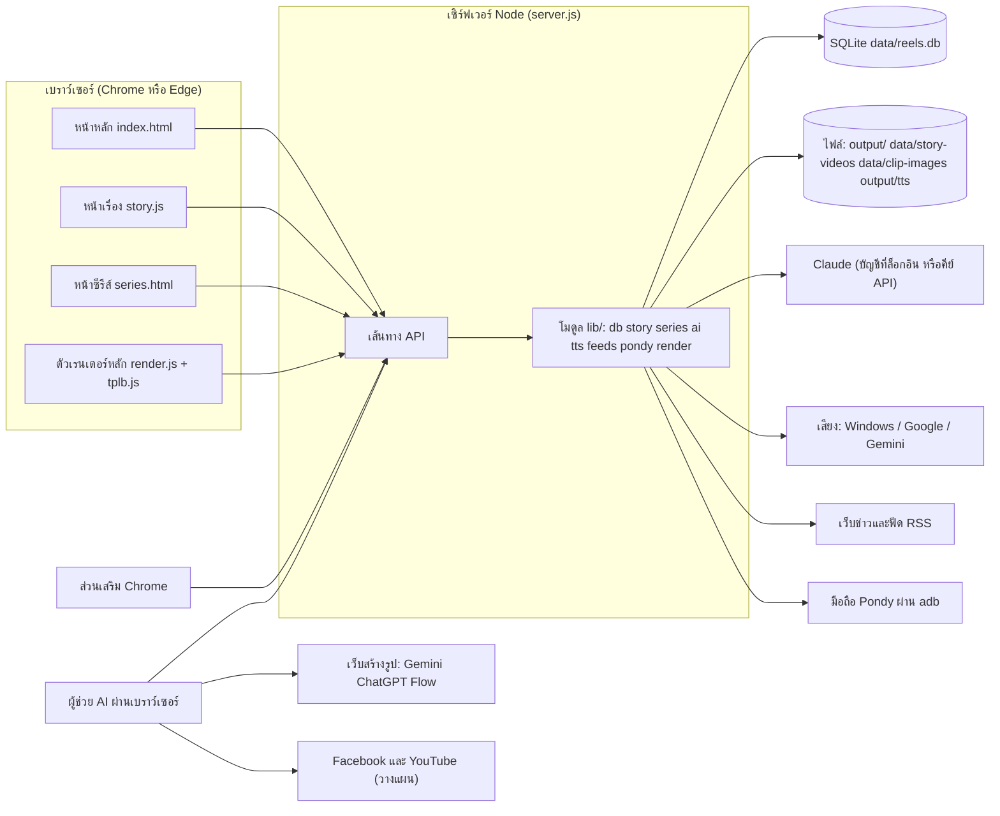

# สถาปัตยกรรมระบบ (System Architecture)

> **อัปเดต 30 ต.ค. 2026:** งานหลักเปลี่ยนเป็นคลิปแนะนำสินค้า (ดู docs/14-product-clips.md และ README.md) คลังสินค้ากลับมาใช้แล้ว ถ้าข้อความในไฟล์นี้ขัดกับ README/14 ให้เชื่อ README/14

ข้อมูลในไฟล์นี้ถอดจากโค้ดที่มีอยู่ ส่วนที่เป็นข้อเสนอเปลี่ยนแปลงอยู่ในข้อ 7 และประเด็นที่ 6 และ 10 ใน 12-decisions.md เทคโนโลยีที่ระบุในข้อ 4 คือสิ่งที่ใช้อยู่จริง ไม่ใช่ข้อเสนอใหม่

## 1. ภาพรวมส่วนประกอบ

## 2. รายละเอียดแต่ละส่วน

### 2.1 เซิร์ฟเวอร์ (`server.js`)
- เซิร์ฟเวอร์ HTTP ของ Node ไม่มีเฟรมเวิร์ก ผูกที่เครื่องตัวเองเท่านั้น (พอร์ตดู ค่าที่ตั้งได้ในระบบ ใน 03-flows.md)
- มีตารางเส้นทาง (รายการ API ใน 06-api-spec.md) และเส้นทางพิเศษที่ตรวจตรง ๆ: ไฟล์สื่อ รูป โลโก้ อัปโหลดไฟล์ และส่วนเสริม
- เสิร์ฟไฟล์หน้าเว็บจาก `public/` เป็นไฟล์ตรง ๆ รองรับ Range สำหรับวิดีโอ
- ตรวจ Host และ Origin ของคำขอ ปฏิเสธเว็บอื่นที่พยายามยิงเข้ามา (11-security.md)

### 2.2 โมดูลหลังบ้าน (`lib/`)
- `db.js` คลิป ฟีด สินค้า และการเปิดฐานข้อมูล
- `story.js` โปรเจกต์เรื่อง คลังตัวละคร ช็อต การสร้างพรอมต์ น้ำเสียงคำบรรยาย
- `series.js` ซีรีส์ งานตอน การลง และกติกา (ป้าย AI, ตอนต่อวัน, ไม่ซ้ำ, ช่องทางต่อตอน)
- `promptimport.js` แยกสคริปต์เป็นช็อตโดยไม่ใช้ AI
- `ai.js` และ `claude-cli.js` เรียก Claude ให้เขียนสคริปต์ แคปชัน สตอรีบอร์ด คำบรรยาย ค้นความรู้
- `tts.js` เสียงบรรยาย แคชเป็นไฟล์ WAV
- `feeds.js` ดึงข่าว RSS และเนื้อบทความ กันลิงก์เข้าเครือข่ายภายใน
- `pondy.js` คัดลอกฐานข้อมูลของแอป Pondy จากมือถือผ่าน adb แล้วอ่านรายการสินค้า
- `brand.js` และ `config.js` สไตล์ประจำเพจ และค่าตั้ง (ไฟล์ `config.json` กับตัวแปรสภาพแวดล้อม)
- `render.js` ตัวเรนเดอร์สำรองด้วย ffmpeg (ดูข้อ 7)
- `ctx.js` ส่งสัญญาณยกเลิกเมื่อหน้าเว็บตัดการเชื่อมต่อ

### 2.3 หน้าเว็บ (`public/`)
- ไม่มีขั้นตอนสร้าง (build) เป็นไฟล์ JavaScript ธรรมดา
- `app.js` หน้าหลัก คลัง ข่าว สินค้า ตั้งค่า และการเรนเดอร์คลิปเร็ว (ประมาณ 1,900 บรรทัด)
- `story.js` หน้าเรื่องทั้งหมด (ประมาณ 1,200 บรรทัด)
- `series.html` และ `series.js` หน้าซีรีส์
- `render.js` ตัวเรนเดอร์หลัก: วาดลงผืนผ้าใบและอัดวิดีโอด้วย MediaRecorder มิกซ์เสียงด้วย Web Audio
- `tplb.js` ชั้นข้อความ มิเตอร์ การ์ด ของเทมเพลต B
- `tplb-test.html` หน้าทดสอบเทมเพลตสำหรับนักพัฒนา (เปิดได้จากเซิร์ฟเวอร์ ดูข้อ 7)
- การ์ดคลิปอัปเดตแบบแก้ส่วนที่เปลี่ยน ไม่วาดใหม่ทั้งก้อน เพื่อไม่ให้ผืนผ้าใบที่กำลังเล่นหาย

### 2.4 ส่วนเสริม Chrome (`extension/`)
- ช่วยดึงรูปหรือคลิปจากหน้าผู้สร้างรูปเข้าช็อตถัดไปที่ยังว่าง ผ่านเส้นทาง `/ext/` ที่ต้องมีรหัสจับคู่ (09-ai-and-voice.md ข้อ 4)

### 2.5 ผู้ช่วย AI และ skill
- skill `reels-episode` (ในโฟลเดอร์ `.claude/skills/`) คือคู่มือขั้นตอนผลิตตอน
- ผู้ช่วย AI เรียก API ของแอปผ่านโปรแกรมเรียก HTTP และใช้เบราว์เซอร์เพื่อเปิดเว็บสร้างรูปและเว็บโพสต์

## 3. รูปแบบการสื่อสาร

| คู่สื่อสาร | โปรโตคอล | ทิศทาง | หมายเหตุ |
|---|---|---|---|
| หน้าเว็บ ↔ เซิร์ฟเวอร์ | HTTP + JSON | สองทาง | เครื่องเดียวกัน ไม่มีรหัสผ่าน |
| หน้าเว็บ → เซิร์ฟเวอร์ (ไฟล์) | HTTP PUT แบบสตรีม | ขาเข้า | วิดีโอ รูป ไฟล์ปก ตรวจลายเซ็นไฟล์จริง |
| เซิร์ฟเวอร์ → Claude | โปรแกรม `claude` แบบไม่มีหน้าจอ หรือ HTTPS ไป API | ขาออก | ปิดเครื่องมือทั้งหมด ทำงานในโฟลเดอร์ว่าง (โหมดบัญชี) |
| เซิร์ฟเวอร์ → เสียงบรรยาย | PowerShell (Windows) หรือ HTTPS (Google, Gemini) | ขาออก | แคชตามข้อความ |
| เซิร์ฟเวอร์ → เว็บข่าว | HTTPS | ขาออก | ปฏิเสธที่อยู่ภายในเครือข่าย |
| เซิร์ฟเวอร์ → มือถือ | `adb` | ขาออก | อ่านสำเนาฐานข้อมูล ไม่แตะต้นฉบับ |
| ส่วนเสริม Chrome → เซิร์ฟเวอร์ | HTTP + รหัสจับคู่ | ขาเข้า | ตรวจ Host Origin และรหัส |
| ผู้ช่วย AI → เซิร์ฟเวอร์ | HTTP (คำสั่ง) | ขาเข้า | เครื่องเดียวกัน |
| ผู้ช่วย AI → เว็บสร้างรูป / โพสต์ | เบราว์เซอร์ที่ล็อกอินไว้ | ขาออก | ผ่านเบราว์เซอร์ ไม่ใช้ API ของเว็บนั้น |
| เว็บภายนอก → เซิร์ฟเวอร์ | ไม่อนุญาต | — | ตรวจ Origin ปฏิเสธ (ประเด็นที่ 11) |

## 4. เทคโนโลยีที่ใช้อยู่จริง

| ส่วน | ที่ใช้ | หมายเหตุ |
|---|---|---|
| รันไทม์ | Node 22.5 ขึ้นไป (ทดสอบบน Node 24) | ไม่มีไลบรารีภายนอก |
| ฐานข้อมูล | SQLite ในตัว Node (`node:sqlite`) โหมด WAL | เก็บใน `data/reels.db` |
| เรนเดอร์ | Canvas + MediaRecorder + Web Audio ในเบราว์เซอร์ | ใช้ Chrome หรือ Edge |
| AI | Claude ผ่านบัญชีที่ล็อกอิน (ค่าเริ่มต้น) หรือคีย์ API | ตั้งในหน้าตั้งค่า |
| เสียงบรรยาย | Windows เสียงไทย, Google Cloud TTS, Gemini TTS | ตั้งในหน้าตั้งค่า |
| โพสต์ (วางแผน) | เบราว์เซอร์ที่ล็อกอินไว้ ผ่านผู้ช่วย AI | ไม่ใช้ Graph API หรือ YouTube Data API (ตัดสินใจแล้ว) |
| ตั้งเวลา (วางแผน) | Claude scheduled task | ประเด็นที่ 12 |

## 5. ความปลอดภัยเบื้องต้น

ระบบออกแบบให้รันบนเครื่องเดียวของเจ้าของ ไม่มีรหัสผ่าน ป้องกันด้วยการผูกที่เครื่องตัวเอง การตรวจ Host และ Origin และรหัสจับคู่ของส่วนเสริม คีย์เก็บฝั่งเซิร์ฟเวอร์ใน `config.json` ไม่ส่งกลับหน้าเว็บ รายละเอียดอยู่ใน 11-security.md

## 6. สภาพแวดล้อม

| สภาพแวดล้อม | ใช้เมื่อ | ที่ต่างกัน |
|---|---|---|
| เครื่องของเจ้าของ (เครื่องเดียว) | ใช้งานจริงและพัฒนา | ใช้ฐานข้อมูลและโฟลเดอร์เดียวกัน ไม่มีเครื่องทดสอบแยก จึงสำรองฐานข้อมูลก่อนแก้โครงสร้างทุกครั้ง (โฟลเดอร์ `backups/`) |

เริ่ม/หยุดด้วย `start.ps1` และ `stop.ps1` ค่าตั้งและคีย์อยู่ใน `config.json`

## 7. ความซ้ำซ้อนที่พบ (ข้อเสนอจัดระบบใหม่)

เจ้าของแจ้งว่ารู้สึกว่าระบบออกแบบยังไม่ดี มีฟังก์ชันซ้ำซ้อน ตารางนี้ถอดจากโค้ดจริง เรียงตามผลกระทบ ทุกข้อเป็นข้อเสนอ **(รอยืนยัน)** ตัดสินใจที่ประเด็นที่ 6 และ 10 ใน 12-decisions.md และจัดลำดับงานใน 13-dev-plan.md

| # | สิ่งที่ซ้ำซ้อน | หลักฐานในโค้ด | ผลเสีย | ข้อเสนอ |
|---|---|---|---|---|
| 1 | ตัวเรนเดอร์สองตัว: ffmpeg ฝั่งเซิร์ฟเวอร์ กับเบราว์เซอร์ | `lib/render.js` และ `POST /api/clips/:id/render` กับ `public/render.js`; เครื่องนี้ไม่มี ffmpeg; README เดิมขัดกันเอง | สับสนว่าตัวไหนจริง ตัว ffmpeg ไม่รู้จักเทมเพลต B และไม่มีใครใช้ | ถือว่าตัวเบราว์เซอร์เป็นตัวหลัก ทำเครื่องหมายตัว ffmpeg ว่าเลิกใช้ (หรือเอาออก) ถ้าอยากเรนเดอร์โดยไม่ต้องเปิดแท็บ ให้เป็นโครงการใหม่ ไม่ใช่ตัวสำรองเดิม |
| 2 | สถานะโพสต์สองที่: คลิป (`posted_at`, `fb_url`) กับตารางการลง | `/api/clips/:id/posted` กับ `publications` | ตอนซีรีส์โพสต์แล้ว แต่คลิปยังเป็น "พร้อมโพสต์" | ซีรีส์ใช้ตารางการลง คลิปใช้กับโพสต์มือ และเมื่อการลงสำเร็จให้อัปเดตคลิปเป็น "โพสต์แล้ว" ด้วย (ข้อเสนอ) |
| 3 | พรอมต์สองระบบ: ของคลิปเร็ว (`video_prompts`, `image_prompts`) กับของช็อต (`story_shots.prompt`) | `/api/clips/:id/prompts`, `/image-prompts` กับ `rebuildPrompts` | ตรรกะสร้างพรอมต์ซ้ำสองชุด | ย้ายคลิปเร็วที่ต้องการพรอมต์ไปเป็นโปรเจกต์เรื่อง (มีปุ่มขยายอยู่แล้ว) แล้วเลิกพรอมต์ในคลิปเร็ว |
| 4 | วิธีนำรูปเข้าช็อต 4 ทาง: แนบทีละไฟล์ แนบหลายไฟล์ ส่วนเสริม Chrome ดาวน์โหลดโดยผู้ช่วย AI | `PUT /api/story/shots/:id/video`, `/ext/shots/:id/video` | ต้องดูแลหลายทาง และผ่านโฟลเดอร์ดาวน์โหลดที่เด้งถาม | รวมเป็นทางเดียวที่แคบและปลอดภัย (ประเด็นที่ 11) |
| 5 | ผู้สร้างรูปไม่ตรงกับที่ใช้จริง: รายการเดิมไม่มี Gemini | `story.GENERATORS` | โปรเจกต์ระบุ Gemini ไม่ได้ | **แก้แล้ว (เฟส 1):** เพิ่ม Gemini แล้ว ส่วนการเลิกตัวที่ไม่ใช้ รอประเด็นที่ 10 |
| 6 | ค่า `draft` กับ `ready` ของช็อต ความหมายเดียวกัน และ `approved` กับ `generated` เกือบเหมือนกัน (ข้อมูลจริงมีแค่ `draft` กับ `generated`) | `SHOT_STATUS` ใน `lib/story.js` | ชุดสถานะรก คำว่าพร้อมสับสน | ลดเป็น ร่าง / มีไฟล์แล้ว / ใช้ได้ / ไม่ผ่าน (ประเด็นที่ 3) |
| 7 | ชื่อเพจสองฟิลด์: `page_name` (เลิกใช้) กับ `channels` | `lib/series.js` | ฟิลด์ค้างเปล่า | ตัดสินใจแล้ว: บันทึกว่าเลิกใช้ เอาออกตอนปรับโครงสร้างครั้งหน้า |
| 8 | สามทางสร้างสตอรีบอร์ด: นำเข้า จากหัวข้อ เรื่องล้อเลียน (ทั้งหมดไปรวมที่ฟังก์ชันสร้างจากสคริปต์เดียวกัน) | `/api/story/import`, `from-topic`, `fan-comedy` | หน้าจอมีสามปุ่ม | เก็บฟังก์ชันรวม แต่รวมปุ่มให้เหลือหนึ่งกล่องสร้างโปรเจกต์ ตัวเลือกแนวเรื่อง |
| 9 | ไฟล์สื่อกระจายหลายโฟลเดอร์: `output/` (คลิป เสียง) `data/story-videos` `data/clip-images` | `lib/db.js`, `server.js` | สำรองข้อมูลยาก | จัดเป็นโฟลเดอร์สื่อเดียว ตัวเลือก ไม่เร่งด่วน |
| 10 | ไฟล์ใหญ่ที่รวมหลายหน้าที่: `server.js` (ประมาณ 1,300 บรรทัด) `app.js` (ประมาณ 1,900) `story.js` (ประมาณ 1,200) | ขนาดไฟล์ | แก้ยาก เสี่ยงพังเมื่อเพิ่มของ | แยกเส้นทางเป็นไฟล์ตามหมวด (คลิป เรื่อง ซีรีส์ ตั้งค่า) ทำเมื่อต้องแตะส่วนนั้นจริง ไม่ทำรวดเดียว |
| 11 | หน้าทดสอบ `tplb-test.html` เปิดได้จากเซิร์ฟเวอร์จริง | `public/tplb-test.html` | ไฟล์ของนักพัฒนาปนกับของผู้ใช้ | ย้ายไปโฟลเดอร์พัฒนา |
| 12 | คำเรียก "คลิป" "เรื่อง" "ตอน" อาจใช้ปนกันในหน้าจอ | ยังไม่ได้ไล่ตรวจข้อความทุกหน้า (ตรวจแล้วเฉพาะหน้าซีรีส์) | ผู้ใช้สับสนว่าตอนซีรีส์กับบทนิยายต่างกันอย่างไร | ใช้ชุดคำใน 01-overview.md ทั้งระบบ รวมถึงข้อความบนหน้าจอ |
| 13 | ~~คลังสินค้าในแอปที่หน้าเว็บเลิกใช้แล้ว~~ | — | — | **ตัดสินใจแล้ว 30 ต.ค. 2026: กลับมาใช้** เป็นแหล่งของคลิปสินค้า (ปุ่ม 🛍 สินค้า, 14-product-clips.md) |

หมายเหตุ: ข้อ 1, 2, 5, 6 เป็นข้อที่กระทบงานอัตโนมัติโดยตรง ข้ออื่นทำภายหลังได้

## 8. เป้าหมายด้านคุณภาพ

| ด้าน | เป้าหมาย |
|---|---|
| ความปลอดภัยของโพสต์ | ไม่มีโพสต์โดยไม่ยืนยันป้ายเนื้อหา AI ไม่มีโพสต์ซ้ำ (บังคับในโค้ดแล้ว) |
| ความทนทานของงานอัตโนมัติ | ล้มแล้วหยุดพร้อมเหตุผล ไม่ลองซ้ำเอง ไม่ทำให้เกิดตอนหรือโพสต์ซ้ำ |
| ความสม่ำเสมอของเสียง | ระดับกลางประมาณ −17 dBFS พีคไม่เกิน −1.5 dBFS (ค่าจากคลิปตัวอย่าง ประเด็นที่ 16) |
| การกู้คืน | สำรองฐานข้อมูลก่อนแก้โครงสร้าง ไฟล์สื่ออยู่ในโฟลเดอร์ข้อมูล |
| การรักษาความเป็นส่วนตัว | คีย์ไม่ส่งกลับหน้าเว็บ ไม่เก็บรหัสผ่านของเว็บภายนอก |
