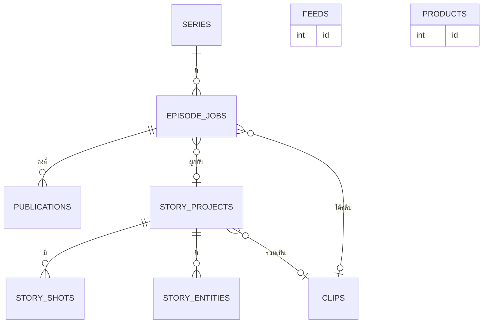

# โครงสร้างข้อมูล (Data Model)

ชื่อ Entity และฟิลด์เป็นภาษาอังกฤษตามชื่อตารางและคอลัมน์จริงในฐานข้อมูล SQLite (`data/reels.db`) ข้อมูลถอดจากฐานข้อมูลจริงเมื่อ 28 ต.ค. 2026 ค่าสถานะแต่ละค่ามีชื่อที่ผู้ใช้เห็นกำกับ และตรงกับตารางสถานะใน 03-flows.md

เวลาทั้งหมดเก็บเป็นเลขมิลลิวินาทีนับจากปี 1970 (ยกเว้นระบุอื่น) ฟิลด์ที่เก็บเป็นข้อความ JSON ระบุว่า "JSON" ฐานข้อมูลไม่มีข้อมูลส่วนบุคคลของบุคคลอื่น (ข้อ 4 ของ 11-security.md)

## 1. แผนภาพความสัมพันธ์

ความสัมพันธ์ระหว่างโปรเจกต์เรื่องกับคลิป ไม่มีฟิลด์ตรง ๆ: คลิปชนิด "เรื่อง" สร้างตอนรวมคลิป และงานตอนซีรีส์เป็นตัวเก็บทั้งเลขโปรเจกต์และเลขคลิป ตารางฟีดและสินค้ายืนอิสระ (ข้อเสนอสินค้าไปอยู่ในแคปชัน ไม่มีฟิลด์ผูกสินค้ากับคลิป)

## 2. รายละเอียด Entity

### CLIPS คลิป (10 แถวตอนตรวจ)
| ฟิลด์ | ชนิด | คำอธิบาย |
|---|---|---|
| id | integer | |
| title | text | ชื่อคลิป |
| brief | text | เนื้อหาตั้งต้น |
| script | text | สคริปต์ หนึ่งบรรทัดต่อหนึ่งฉาก |
| caption | text | แคปชัน |
| hashtags | text | แฮชแท็ก |
| theme | text | สไตล์พื้นหลัง (ค่าเริ่มต้น dark) |
| status | enum | draft (ร่าง), rendering (กำลังเรนเดอร์), ready (พร้อมโพสต์), failed (ล้มเหลว), posted (โพสต์แล้ว) |
| video_file | text | ชื่อไฟล์วิดีโอใน `output/` |
| duration | real | ความยาว (วินาที) |
| error | text | ข้อความผิดพลาดตอนเรนเดอร์ |
| voice | integer | 1 = ใส่เสียงบรรยาย |
| music | text | none, calm (สงบ), mystic (ลึกลับ), upbeat (สนุก) |
| target_sec | integer | ความยาวเป้าหมาย 0 หรือ 5 ถึง 90 (0 = อัตโนมัติ) |
| video_prompts, image_prompts | text | พรอมต์ที่ AI เขียนให้ (ซ้ำซ้อนกับช็อต ดู 04-architecture.md ข้อ 7) |
| images | text | JSON รูปพื้นหลังที่เลือก |
| badge | text | ป้ายหัวคลิป |
| source | text | ที่มาของเนื้อหา |
| kind | enum | quick (เร็ว), story (เรื่อง), product (คลิปสินค้า) |
| narr_tone | text | สไตล์เสียงพากย์ (คีย์ของ `story.NARR_TONES` ใช้ร่วมทุกโหมด ค่าเริ่มต้น plain) |
| product_id | integer | สินค้าต้นทางของคลิปสินค้า (0 = ไม่มี) |
| raw_video | text | วิดีโอดิบจาก Meta AI ใน `data/product-videos/` |
| fb_comment | text | คอมเมนต์แรกของโพสต์ (มีลิงก์แอฟฟิลิเอต) |
| posted_at | integer | เวลาทำเครื่องหมายโพสต์มือ |
| fb_url | text | ลิงก์โพสต์ที่เจ้าของใส่ (โพสต์มือ) |
| created_at, updated_at | integer | |

### FEEDS ฟีดข่าว (2 แถว)
| ฟิลด์ | ชนิด | คำอธิบาย |
|---|---|---|
| id | integer | |
| name | text | ชื่อฟีด |
| url | text | ลิงก์ RSS หรือ Atom |
| created_at | integer | |

### PRODUCTS สินค้าแอฟฟิลิเอต (ใช้งานอยู่ — แหล่งของคลิปสินค้า ดู 14-product-clips.md)
| ฟิลด์ | ชนิด | คำอธิบาย |
|---|---|---|
| id | integer | |
| name | text | ชื่อสินค้า |
| url | text | ลิงก์แอฟฟิลิเอต |
| tags | text | แท็ก |
| note | text | โน้ต |
| sales | integer | ยอดขาย ใช้จัดอันดับ |
| src | text | ที่มา: `''` เพิ่มเอง, `pondy:<serial>` นำเข้าจากมือถือ (ใช้ตอนล้างสินค้านำเข้า), `shopee-aff` จากแผงหาสินค้า |
| item_id | text | รหัสสินค้า Shopee (กันเก็บซ้ำ) |
| image | text | ไฟล์รูปสินค้าใน `data/clip-images/` |
| brand, clip_name, say | text | แบรนด์ ชื่อในคลิป คำอ่าน (เติมลง prompt คลิปสินค้า) |
| last_posted | integer | เวลาที่เคยลงล่าสุด |
| created_at | integer | |

### STORY_PROJECTS โปรเจกต์เรื่อง (10 แถวตอนตรวจ)
| ฟิลด์ | ชนิด | คำอธิบาย |
|---|---|---|
| id | integer | |
| title | text | ชื่อเรื่อง |
| premise | text | เรื่องย่อหรือสคริปต์ต้นฉบับ |
| total_sec, shot_sec | integer | ความยาวรวมและต่อช็อตตามแผน |
| aspect | enum | 9:16, 4:5, 1:1, 16:9 |
| style | text | โทนภาพ (ว่าง = ใช้สไตล์ประจำเพจ) |
| media | enum | image (ภาพนิ่งต่อช็อต), video (วิดีโอสั้นต่อช็อต) |
| generator | enum | flow, chatgpt, gemini, meta, seedance (ผู้สร้างรูป Gemini ใช้ได้กับแบบงานภาพนิ่งเท่านั้น แบบวิดีโอจะเปลี่ยนเป็น flow) |
| per_image | integer | จำนวนช็อตต่อรูป: 1, 4, 6, 12 |
| look | text | JSON โทนภาพ: ref light film sound |
| narr_tone | text | น้ำเสียงคำบรรยาย (plain, deadpan ฯลฯ) |
| sources | text | JSON ลิงก์แหล่งข้อมูล |
| template | enum | plain (ธรรมดา), b (สปอยล์ภาพนิ่ง เทมเพลต B) |
| tpl | text | JSON ค่าเทมเพลต B: epLabel meterLabel meter cover coverAfter end |
| created_at, updated_at | integer | |

### STORY_ENTITIES คลังตัวละคร/สถานที่/ของประกอบ (55 แถวตอนตรวจ)
| ฟิลด์ | ชนิด | คำอธิบาย |
|---|---|---|
| id, project_id | integer | |
| kind | enum | character (ตัวละคร), location (สถานที่), prop (ของประกอบ) |
| name | text | ชื่อ |
| desc | text | คำอธิบายภาพ (อังกฤษ) ใส่ซ้ำทุกพรอมต์ |
| notes | text | โน้ตของเรา ไม่ใส่ในพรอมต์ |
| alias | text | ชื่อเรียกอื่น |
| position | integer | ลำดับ |

### STORY_SHOTS ช็อต (52 แถวตอนตรวจ)
| ฟิลด์ | ชนิด | คำอธิบาย |
|---|---|---|
| id, project_id, position | integer | |
| scene, beat | text | ชื่อฉาก และสรุปสั้น |
| location_id | integer | สถานที่ (ชี้คลังตัวละคร) |
| character_ids, prop_ids | text | JSON เลขตัวละคร/ของประกอบ |
| action, camera | text | การกระทำและมุมกล้อง |
| narration | text | คำบรรยายที่อ่านเป็นเสียง |
| visible_text | text | ข้อความที่ปรากฏในภาพ |
| duration | integer | ความยาว (วินาที) |
| state_before, state_after | text | สถานะต้นและท้ายช็อต ใช้เตือนเมื่อไม่ต่อกัน |
| prompt | text | พรอมต์ที่ระบบสร้างและแก้ได้ |
| status | enum | draft (ร่าง), ready (รอไฟล์ใหม่ ความหมายเดียวกับร่าง), generated (มีไฟล์แล้ว), approved (ใช้ได้), rejected (ไม่ผ่าน) |
| video_file | text | ไฟล์รูปหรือคลิปของช็อตใน `data/story-videos` |
| video_file2 | text | รูปที่สอง สำหรับเลย์เอาต์แบ่งสองช่อง |
| note | text | โน้ตรีวิว |
| caption | text | ข้อความกล่องล่างของเทมเพลต B ครอบคำเน้นด้วย `{{ }}` |
| sfx_text | text | คำเสียงตัวใหญ่ (ไม่เกิน 30 ตัวอักษร) |
| meter | integer | ระดับสปอยล์ 0 ถึง 5 (0 = อัตโนมัติ) |
| layout | enum | full (เต็มจอ), plate (แผ่นภาพ), split (แบ่งสองช่อง) |
| created_at, updated_at | integer | |

### SERIES ซีรีส์
| ฟิลด์ | ชนิด | คำอธิบาย |
|---|---|---|
| id | integer | |
| title | text | ชื่อซีรีส์ |
| source_notes | text | แหล่งอ่านเนื้อเรื่อง ลิงก์ หมายเหตุ |
| next_ep | integer | ตอนซีรีส์ถัดไปที่จะผลิต (เพิ่มเองเมื่อเริ่มตอน) |
| channels | text | JSON ชื่อเพจ/ช่อง: facebook, youtube |
| channel_ids | text | JSON รหัสหรือลิงก์เพจ/ช่อง ใช้ยืนยันว่าเปิดถูกเพจ: facebook, youtube |
| chapter_start | integer | บทนิยายที่เริ่มตอนซีรีส์แรก (ค่าเริ่มต้น 1) |
| chapters_per_ep | integer | จำนวนบทนิยายต่อหนึ่งตอนซีรีส์ 1 ถึง 20 (ค่าเริ่มต้น 1) |
| page_name | text | **เลิกใช้** (ย้ายไป channels แล้ว) |
| post_time | text | เวลาที่ตั้งใจโพสต์ รูปแบบ HH:MM |
| per_day | integer | ตอนต่อวันสูงสุด 1 ถึง 5 |
| platforms | text | JSON ช่องทางตั้งต้นของซีรีส์: facebook, youtube |
| ai_label | integer | ป้ายเนื้อหา AI บังคับ ค่าเป็น 1 เสมอ แก้เป็นปิดไม่ได้ |
| visual | enum | anime (อนิเมะ), cartoon (การ์ตูน), realistic (สมจริง), stickman (สติ๊กแมน) |
| tpl | text | JSON ค่าเทมเพลต B ระดับซีรีส์ ใช้ `{ep}` แทนเลขตอน |
| enabled | integer | 1 = เปิด ค่าเริ่มต้น 0 (ปิด) |
| created_at, updated_at | integer | |

### EPISODE_JOBS งานผลิตตอน
| ฟิลด์ | ชนิด | คำอธิบาย |
|---|---|---|
| id | integer | |
| series_id | integer | |
| ep_no | integer | เลขตอนซีรีส์ ไม่ซ้ำภายในซีรีส์เดียวกัน (บังคับด้วยดัชนีเฉพาะ) |
| status | enum | research (ค้นเนื้อเรื่อง), storyboard (เขียนสตอรีบอร์ด), images (ทำรูป), render (รวมคลิป), ready (พร้อมโพสต์), done (ลงครบแล้ว), failed (ล้มเหลว) |
| project_id | integer | โปรเจกต์เรื่องที่ผูก |
| clip_id | integer | คลิปที่รวมเสร็จ |
| platforms | text | JSON ช่องทางของตอนนี้ ว่าง (null) = ตามซีรีส์ |
| chapter_range | text | ช่วงบทนิยายของตอนนี้ เช่น 3 หรือ 3-5 คำนวณตอนเริ่มตอนจากบทเริ่มต้นและบทต่อตอน (ตามเลขตอน) แก้เองได้ ว่าง = ไม่กำหนด |
| error | text | เหตุผลที่ล้ม |
| created_at, updated_at | integer | |

### PUBLICATIONS การลง
| ฟิลด์ | ชนิด | คำอธิบาย |
|---|---|---|
| id | integer | |
| job_id | integer | |
| platform | enum | facebook, youtube ไม่ซ้ำต่อตอน (บังคับด้วยดัชนีเฉพาะ) |
| status | enum | pending (รอลง), posting (กำลังลง), posted (ลงแล้ว), failed (ล้มเหลว), blocked (ถูกหยุด) |
| url | text | ลิงก์โพสต์ ต้องเป็น https ถ้าสถานะลงแล้ว |
| ai_label_verified | integer | 1 = ยืนยันป้ายเนื้อหา AI แล้ว ต้องเป็น 1 ถึงจะตั้ง "ลงแล้ว" ได้ |
| error | text | เหตุผลที่ล้มหรือถูกหยุด |
| posted_at | integer | เวลาที่ลงแล้ว |
| created_at, updated_at | integer | |

## 3. ค่าตั้งระบบ

ค่าตั้งส่วนใหญ่ไม่ได้อยู่ในฐานข้อมูล อยู่ใน `config.json` (หรือตัวแปรสภาพแวดล้อม) และค่าคงที่ในโค้ด ตารางนี้บอกว่าแต่ละค่าใน "ค่าที่ตั้งได้ในระบบ" (03-flows.md) เก็บที่ใด โดยไม่เขียนค่าเริ่มต้นซ้ำ

| ค่า (ชื่อในตาราง 03-flows.md) | ที่เก็บ |
|---|---|
| ความยาวคลิปเร็วสูงสุด, ความยาวเป้าหมาย | ค่าคงที่ในตัวเรนเดอร์ และฟิลด์ `clips.target_sec` |
| ความยาวคลิปรวมเรื่องสูงสุด | ค่าคงที่ในตัวเรนเดอร์ |
| ขนาดไฟล์คลิปที่ส่งเข้าคลังสูงสุด, ขนาดรูป, ขนาดคลิปที่แนบ | ค่าคงที่ใน `server.js` |
| เวลาเริ่มต้นของช็อต | ฟิลด์ `story_projects.shot_sec` |
| ความยาวสูงสุดของช็อต, จำนวนฉากสูงสุด, ความยาวสคริปต์สูงสุด | ค่าคงที่ใน `lib/promptimport.js` และ `server.js` |
| การ์ดปก, การ์ดจบ, แทรกการ์ดปกหลังช็อตที่ | ฟิลด์ `story_projects.tpl` และ `series.tpl` |
| ช็อตต่อรูป | ฟิลด์ `story_projects.per_image` |
| ตอนต่อวันสูงสุดของซีรีส์ | ฟิลด์ `series.per_day` |
| เวลาที่ตั้งใจโพสต์ | ฟิลด์ `series.post_time` |
| ช่องทางเริ่มต้นของซีรีส์ | ฟิลด์ `series.platforms` |
| เริ่มงานก่อนเวลาโพสต์, ช่วงเว้นหลัง Facebook ก่อน YouTube, ลองใหม่ต่อช็อต | ยังไม่มีที่เก็บ จะอยู่ในงานตั้งเวลา **(วางแผน)** |
| พอร์ตเซิร์ฟเวอร์ | `config.json` คีย์ port |
| ความเร็วเสียงบรรยาย | `config.json` คีย์ ttsRate |
| เป้าความดังเสียงเทมเพลต B | ค่าคงที่ในตัวเรนเดอร์ |

ค่าอื่นใน `config.json` ที่ไม่อยู่ในตารางนั้น: ผู้ให้บริการ AI และโมเดล คีย์ Claude, Gemini, Google เสียงที่เลือก รหัสจับคู่ส่วนเสริม สไตล์ประจำเพจ ที่อยู่ของ `claude`, `adb`, `ffmpeg` และฟอนต์

## 4. ข้อมูลตั้งต้นที่ต้องมีก่อนเปิดใช้

| ข้อมูล | จำนวน | ที่มา |
|---|---|---|
| ซีรีส์อย่างน้อย 1 เรื่อง พร้อมแหล่งอ่าน ช่องทาง ชื่อเพจ/ช่อง | 1 | เจ้าของตั้งในหน้าซีรีส์ (ซีรีส์ "คัมภีร์วิถีเซียน" ตั้งแล้ว ชื่อเพจ/ช่องยังรอตรวจ ประเด็นที่ 13) |
| ค่าเทมเพลต B ระดับซีรีส์ | 1 ชุด | เจ้าของ (ตั้งแล้วในซีรีส์ตัวอย่าง) |
| ผู้ให้บริการ AI ที่ใช้ได้ | 1 | เจ้าของ ในหน้าตั้งค่า |
| ผู้ให้บริการเสียงบรรยายที่ใช้ได้ | 1 | เจ้าของ ในหน้าตั้งค่า |
| บัญชีที่ล็อกอินค้างในเบราว์เซอร์: ผู้สร้างรูป, Facebook, YouTube | 3 | เจ้าของล็อกอินเอง |
